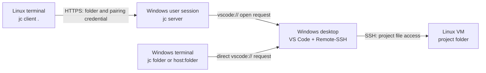

# Jumpcode (`jc`)

[简体中文](README.md)

## Purpose

Jumpcode solves a specific workflow problem: while working in a Linux VM terminal, you want VS Code on your Windows desktop to open the **current Linux folder** without switching to Windows to type the host and path. Run `jc client .` on Linux to request that remote folder in Windows VS Code.

On Windows, the same `jc` command can open a local folder or a `host:folder` Remote-SSH project. Direct Windows commands do not need the server. Jumpcode does not copy project files, run VS Code on Linux, or provide a public relay. Remote files stay on Linux and are accessed by VS Code Remote-SSH.

## Architecture



Linux sends the folder path and pairing credential to Windows over HTTPS. VS Code on Windows then accesses the Linux project over SSH. Project files stay on Linux. See [Architecture](docs/architecture.en.md) for pairing and identity verification.

## Installation

Download `v0.2.0` from [GitHub Releases](https://github.com/pi12138/jumpcode/releases/tag/v0.2.0). The release provides **Windows amd64** and **Linux amd64** binaries for Intel/AMD 64-bit systems. Go is not required. See the [release notes](docs/releases/v0.2.0.en.md) for known limitations.

### Windows

Download the [Windows ZIP](https://github.com/pi12138/jumpcode/releases/download/v0.2.0/jumpcode_v0.2.0_windows_amd64.zip) and [SHA256SUMS](https://github.com/pi12138/jumpcode/releases/download/v0.2.0/SHA256SUMS) to your Downloads folder. Use `Get-FileHash -Algorithm SHA256` on the ZIP and compare the hash with its entry in the checksum file.

Extract the complete release package to a stable folder and add that folder to your user `PATH` in PowerShell:

```powershell
$jcDir = Join-Path $env:LOCALAPPDATA 'Programs\Jumpcode'
Expand-Archive -Path "$HOME\Downloads\jumpcode_v0.2.0_windows_amd64.zip" -DestinationPath $jcDir
$userPath = [Environment]::GetEnvironmentVariable('Path', 'User')
if (($userPath -split ';') -notcontains $jcDir) {
    [Environment]::SetEnvironmentVariable('Path', "$jcDir;$userPath", 'User')
}
$env:Path = "$jcDir;$env:Path"
jc --version
```

New terminals will inherit the updated `PATH`. Windows also needs VS Code desktop, Remote-SSH, and an OpenSSH client. Before replacing `jc.exe`, stop a manual background server with `jc server stop`, or a scheduled server with `jc task stop`. See [Upgrades and task configuration](docs/usage.en.md#upgrades-and-task-configuration).

### Linux

Download, verify, and install into the current user's `~/.local/bin`:

```sh
jc_version=v0.2.0
jc_archive="jumpcode_${jc_version}_linux_amd64.tar.gz"
jc_download_dir="$(mktemp -d)"
cd "$jc_download_dir"
curl -fL -O "https://github.com/pi12138/jumpcode/releases/download/$jc_version/$jc_archive"
curl -fL -O "https://github.com/pi12138/jumpcode/releases/download/$jc_version/SHA256SUMS"
mkdir -p "$HOME/.local/bin"
if sha256sum --ignore-missing -c SHA256SUMS; then
    tar -xzf "$jc_archive" && install -m 755 jc "$HOME/.local/bin/jc"
fi
export PATH="$HOME/.local/bin:$PATH"
jc --version
```

Ensure the checksum reports `OK` before extracting and installing. Add `export PATH="$HOME/.local/bin:$PATH"` to your shell startup file, such as `~/.bashrc` or `~/.zshrc`, to keep `jc` available in future terminals. For source builds, see the [development guide](docs/development.en.md).

## Quick start

After installation, check that Windows can SSH into Linux and Linux can reach the Windows server's listen address.

### 1. Start the Windows server and create credentials

This example uses `me@192.168.56.10` as the Linux SSH destination. Replace it with yours, or use a configured SSH alias.

```powershell
jc server --listen auto --daemon
jc server status
jc pair create --name devvm --ssh-host me@192.168.56.10
```

Keep the certificate fingerprint and the pairing token shown only once. Choose a listen address reachable from Linux from the server status output.

### 2. Pair and open the project from Linux

Keep the Windows server running, replace the address and fingerprint below, and paste the pairing token when prompted. Token input is not echoed.

```sh
jc pair join --server 192.168.56.1:59684 --fingerprint 'paste the certificate fingerprint printed on Windows'
cd /home/me/project
jc client .
```

VS Code on Windows should attempt to open the folder through Remote-SSH in a new window. If the same folder on the same SSH host is already open, VS Code activates its existing window. Check its window for the final connection result.

Start the background server manually with `jc s -d`, check it with `jc s status`, and stop it with `jc s stop`. See [Server operation and management](docs/usage.en.md#server-operation-and-management) for details.

### 3. Enable Windows sign-in startup if needed

Manage Windows sign-in startup through `jc task`. If you started the manual background server above, run `jc s stop` first, then install and start the task:

```powershell
jc task install --listen auto
jc task start
jc task status
```

Installation only registers the task; `start` runs it immediately. Future sign-ins start it automatically for the current user. `jc task stop` stops the current run. `jc task uninstall` stops the server and removes sign-in startup while preserving credentials and logs.

Task Scheduler directly runs the same `jc.exe server`, which detaches from the console in its own process. Logs are at `%APPDATA%\jumpcode\server.log`. A window may still flash briefly during startup. See [Task management](docs/usage.en.md#task-management). If you installed an older task, follow [Legacy task cleanup](docs/usage.en.md#legacy-task-cleanup) first.

`auto` mode subscribes to Windows network notifications. It adjusts listeners after Wi-Fi or VPN changes and stays running through temporary network loss. See [Network changes and automatic listeners](docs/usage.en.md#network-changes-and-automatic-listeners).

## Documentation

- [Find your scenario](docs/usage.en.md#find-your-scenario): LAN development hosts, SSH callbacks from cloud servers, Tailscale, multiple hosts, and network recovery.
- [Usage guide](docs/usage.en.md): initial setup, listen addresses, credentials, background operation, and troubleshooting.
- [Architecture](docs/architecture.en.md): component responsibilities, connection directions, and pairing.
- [Development guide](docs/development.en.md): source layout, builds, cross-compilation, and verification commands.
- [v0.2.0 release notes](docs/releases/v0.2.0.en.md): features, artifacts, and known limitations.
