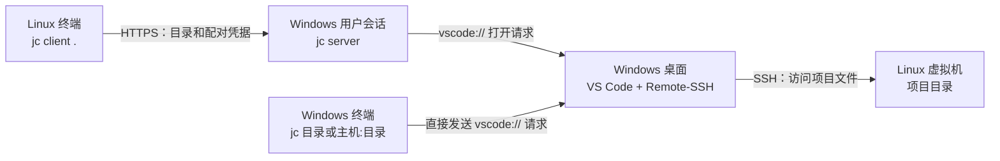

# Jumpcode (`jc`)

[English](README.en.md)

## 项目目的

Jumpcode 解决的是一个具体问题：人在 Linux 虚拟机的终端里工作，想用 Windows 桌面上的 VS Code 打开**当前 Linux 目录**，又不想每次回到 Windows 手动输入主机和路径。在 Linux 中运行 `jc client .`，Windows 上的 VS Code 就会收到打开该远程目录的请求。

同一个 `jc` 命令在 Windows 上也能打开本地目录，或指定 `主机:目录` 打开 Remote-SSH 项目。这种直接打开方式不需要启动服务端。Jumpcode 不复制项目文件、不在 Linux 上启动 VS Code，也不提供公网中转；远程文件仍在 Linux，由 VS Code Remote-SSH 访问。

## 运行架构



Linux 通过 HTTPS 向 Windows 发送目录和配对凭据；Windows 上的 VS Code 再通过 SSH 访问 Linux 项目文件。项目文件保留在 Linux 上。配对关系与身份校验见[架构说明](docs/architecture.md)。

## 安装

从 [GitHub Releases](https://github.com/pi12138/jumpcode/releases/tag/v0.1.1) 下载 `v0.1.1`。提供 **Windows amd64** 和 **Linux amd64**（Intel/AMD 64 位）二进制，无需安装 Go。已知限制见[发布说明](docs/releases/v0.1.1.md)。

### Windows

下载 [Windows ZIP](https://github.com/pi12138/jumpcode/releases/download/v0.1.1/jumpcode_v0.1.1_windows_amd64.zip) 和 [SHA256SUMS](https://github.com/pi12138/jumpcode/releases/download/v0.1.1/SHA256SUMS) 到“下载”目录。可用 `Get-FileHash -Algorithm SHA256` 计算 ZIP 的哈希，与校验文件中的对应项核对。

在 PowerShell 中将完整发布包解压到固定目录，并将该目录加入当前用户的 `PATH`：

```powershell
$jcDir = Join-Path $env:LOCALAPPDATA 'Programs\Jumpcode'
Expand-Archive -Path "$HOME\Downloads\jumpcode_v0.1.1_windows_amd64.zip" -DestinationPath $jcDir
$userPath = [Environment]::GetEnvironmentVariable('Path', 'User')
if (($userPath -split ';') -notcontains $jcDir) {
    [Environment]::SetEnvironmentVariable('Path', "$jcDir;$userPath", 'User')
}
$env:Path = "$jcDir;$env:Path"
jc --version
```

后续新开的终端会使用更新后的 `PATH`。Windows 还需要安装 VS Code 桌面版、Remote-SSH 扩展和 OpenSSH 客户端。替换 `jc.exe` 前，手动后台模式用 `jc server stop` 停止服务，计划任务模式用 `jc task stop`；详见[升级与修改任务配置](docs/usage.md#升级与修改任务配置)。

### Linux

以下命令下载、校验并安装到当前用户的 `~/.local/bin`：

```sh
jc_version=v0.1.1
jc_archive="jumpcode_${jc_version}_linux_amd64.tar.gz"
jc_download_dir="$(mktemp -d)"
cd "$jc_download_dir"
curl -fL -O "https://github.com/pi12138/jumpcode/releases/download/$jc_version/$jc_archive"
curl -fL -O "https://github.com/pi12138/jumpcode/releases/download/$jc_version/SHA256SUMS"
mkdir -p "$HOME/.local/bin"
if sha256sum --ignore-missing -c SHA256SUMS; then
    tar -xzf "$jc_archive" && install -m 755 jc "$HOME/.local/bin/jc"
fi
export PATH="$HOME/.local/bin:$PATH"
jc --version
```

确认校验结果为 `OK` 后再解压安装。将 `export PATH="$HOME/.local/bin:$PATH"` 加入当前 shell 的启动文件（如 `~/.bashrc` 或 `~/.zshrc`），让后续终端也能直接使用 `jc`。如果需要从源码构建，参见[开发指南](docs/development.md)。

## 快速开始

安装后，确认 Windows 能 SSH 登录 Linux，Linux 也能访问 Windows 服务的监听地址。

### 1. Windows 启动服务并创建凭据

以下示例中，Linux SSH 地址为 `me@192.168.56.10`。请替换为实际地址；也可使用已配置的 SSH 别名。

```powershell
jc server --listen auto --daemon
jc server status
jc pair create --name devvm --ssh-host me@192.168.56.10
```

记下证书指纹和仅显示一次的配对密钥，从服务状态中选择 Linux 能访问的监听地址。

### 2. Linux 配对并打开项目

保持 Windows 服务运行，替换下面的地址和证书指纹，并在提示时粘贴配对密钥。密钥输入不会回显。

```sh
jc pair join --server 192.168.56.1:59684 --fingerprint '粘贴 Windows 输出的证书指纹'
cd /home/me/project
jc client .
```

Windows 上的 VS Code 会尝试通过 Remote-SSH 打开该目录，最终连接结果以 VS Code 窗口为准。

使用 `jc s -d` 手动启动后台服务，`jc s status` 查看状态，`jc s stop` 停止服务。完整操作见[服务端运行与管理](docs/usage.md#服务端运行与管理)。

### 3. 按需启用 Windows 登录自启

当前源码版通过 `jc task` 管理 Windows 登录自启；已发布的 v0.1.1 尚不提供这组命令。如果已按上文启动手动后台服务，先执行 `jc s stop`，再安装并启动任务：

```powershell
jc task install --listen auto
jc task start
jc task status
```

安装只注册任务，`start` 立即启动，以后在当前用户登录后自动启动。`jc task stop` 停止本次运行；`jc task uninstall` 停止服务并移除登录自启，保留配对凭据和日志。

任务计划程序直接运行同一个 `jc.exe server`，服务在自身进程中脱离控制台，日志位于 `%APPDATA%\jumpcode\server.log`。启动瞬间仍可能短暂闪窗。详见[计划任务管理](docs/usage.md#计划任务管理)。曾安装旧版任务的用户，请先按[旧版任务清理说明](docs/usage.md#旧版任务清理)卸载旧任务。

## 文档

- [使用指南](docs/usage.md)：首次配置、监听地址、凭据管理、后台服务和故障排查。
- [架构说明](docs/architecture.md)：组件职责、连接方向和配对机制。
- [开发指南](docs/development.md)：源码布局、构建、交叉编译和验证命令。
- [v0.1.1 发布说明](docs/releases/v0.1.1.md)：版本功能、发布产物和已知限制。
