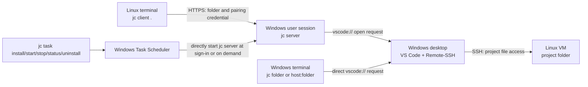

# Architecture

[Project home](../README.en.md) · [Usage](usage.en.md) · [Architecture](architecture.en.md) · [Development](development.en.md) · [简体中文](architecture.md)

There are two distinct connections. Linux-to-Windows HTTPS carries control information such as the folder path and authentication credential, not project files. VS Code on Windows then connects to Linux over SSH to read and edit project files. For Linux-initiated opens, Windows must be able to SSH into the VM, and the VM must be able to reach the Windows server's listen address. Running `jc devvm:/home/me/project` on Windows takes the direct path in the diagram without `jc server`; opening a local Windows folder needs no SSH connection either.

## Components

| Component | Location and responsibility |
| --- | --- |
| `jc server` | Runs in the signed-in Windows user's session, listens on HTTPS, verifies client credentials, and asks Windows to open VS Code through its registered `vscode://` handler. Start it manually in the foreground or background. |
| `jc task` | Uses the native Windows Task Scheduler COM interface to register, start, query, and delete the sign-in task. Requests graceful stopping through the authenticated local control endpoint. The task directly runs the same `jc.exe server`. |
| `jc client` | Runs briefly on the Linux VM, resolves the folder to an absolute path, and requests an open from the paired Windows server. It does not stay running. |
| VS Code + Remote-SSH | Runs on the Windows desktop and establishes the actual SSH connection to Linux. Jumpcode can only confirm that the launch request was accepted; check the VS Code window for the final result. |

In task mode, the process launched by Task Scheduler detaches from its console with `FreeConsole`, executes the server itself, and reports its own PID. Standard output and standard error connect to the server log. Management commands exit after use; there is no extra resident monitor. Task state uses `task.json`, while manual background state uses `daemon.json`. Their respective status and stop commands use the corresponding state file to reach the local control endpoint. Both modes share logs, pairings, and certificates.

## Pairing and identity verification

Initial use requires pairing. Windows issues a pairing token shown only once and binds it to a fixed SSH host. Linux stores the server address, certificate fingerprint, and token. Subsequent requests authenticate with the token, and the client pins the server certificate fingerprint. The server opens only the SSH host associated with the pairing; clients cannot select another host per request. Each Linux user's client config stores one Windows server address, while the Windows server may listen on multiple IPs.

Each pairing has its own token so it can be revoked independently and identifies its bound SSH host. The certificate fingerprint belongs to the Windows server. Pairings under the same user config folder share a fingerprint; restarting the server or changing listen IPs does not change it. Keep tokens private; certificate fingerprints can be public. This fingerprint is separate from the Linux SSH host fingerprint.
