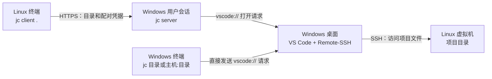

# 架构说明

[项目首页](../README.md) · [使用指南](usage.md) · [架构说明](architecture.md) · [开发指南](development.md) · [English](architecture.en.md)

这里有两条不同的连接：Linux 到 Windows 的 HTTPS 传输目录路径和认证信息等**控制信息，不传项目文件**；Windows 上的 VS Code 再通过 SSH 连接 Linux，读取和编辑项目文件。使用 Linux 发起方式时，Windows 必须能 SSH 登录虚拟机，虚拟机也必须能访问 Windows 服务端的监听地址。仅从 Windows 执行 `jc devvm:/home/me/project` 时，走图中的直接打开路径，不经过 `jc server`；打开 Windows 本地目录则连 SSH 也不需要。

## 组件职责

| 组件 | 运行位置与职责 |
| --- | --- |
| `jc server` | 在当前登录用户的 Windows 会话中监听 HTTPS，验证客户端凭据，并通过 Windows 注册的 `vscode://` 协议请求打开 VS Code。可手动以前台或后台方式运行。 |
| `jc client` | 在 Linux 虚拟机中临时运行；把目录解析为绝对路径，向已配对的 Windows 服务端发送请求，不常驻后台。 |
| VS Code + Remote-SSH | 运行在 Windows 桌面；真正建立到 Linux 的 SSH 连接。Jumpcode 只能确认打开请求已被接受，最终连接结果以 VS Code 窗口为准。 |

## 配对与身份校验

首次使用需要配对：Windows 为虚拟机生成仅显示一次的配对密钥，并把它绑定到固定的 SSH 主机名；Linux 保存服务端地址、证书指纹和密钥。后续请求用密钥认证，客户端用指纹校验服务端证书；服务端只会打开该配对绑定的 SSH 主机，不接受客户端临时指定其他主机。每个 Linux 用户的客户端配置只保存一个 Windows 服务端地址；Windows 服务端则可监听多个 IP。

每条配对记录使用独立密钥，以便单独撤销并确定绑定的 SSH 主机。证书指纹属于 Windows 服务端；同一用户配置目录中的多个配对共用同一指纹，重启服务或更换监听 IP 不会改变它。密钥应保密，证书指纹可以公开；这里的指纹不是 Linux 的 SSH 主机指纹。
